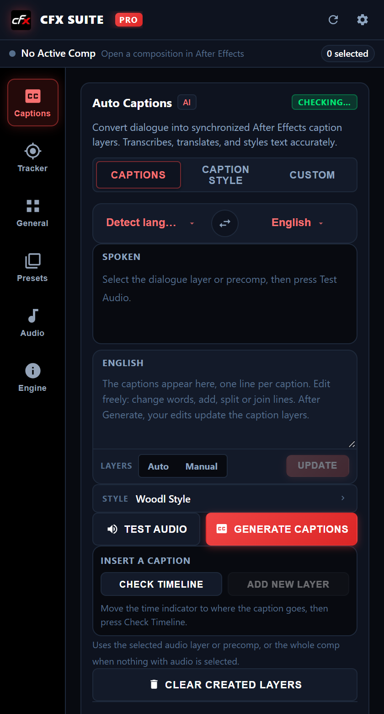
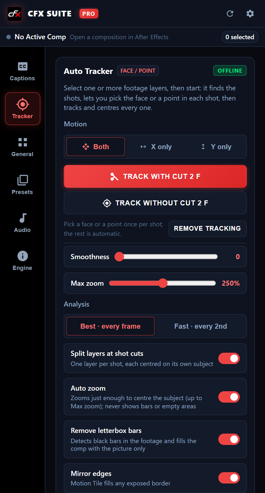
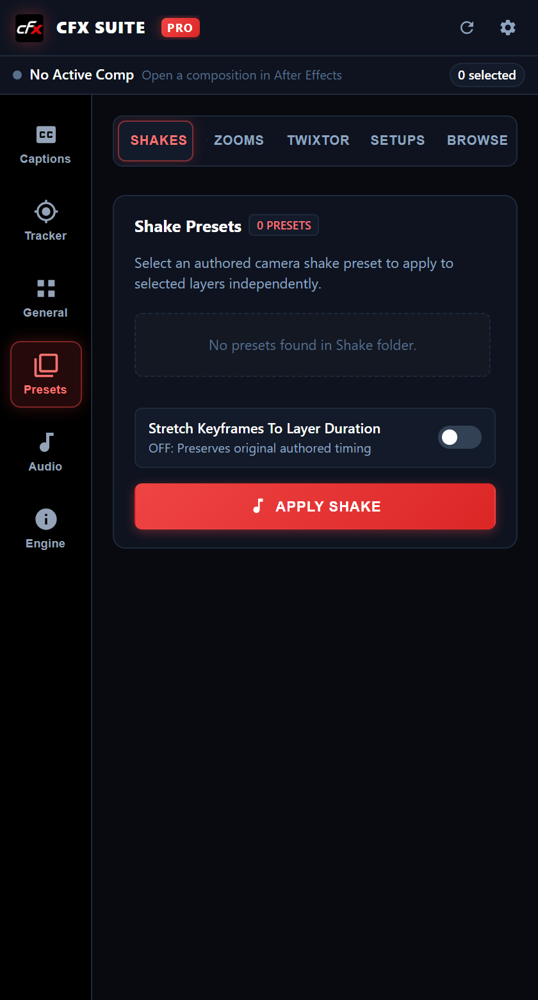
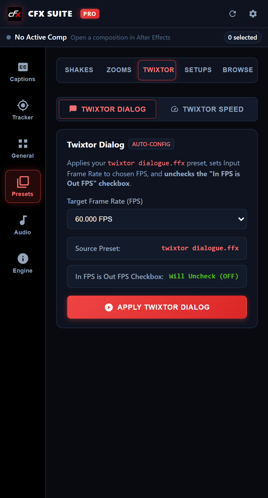
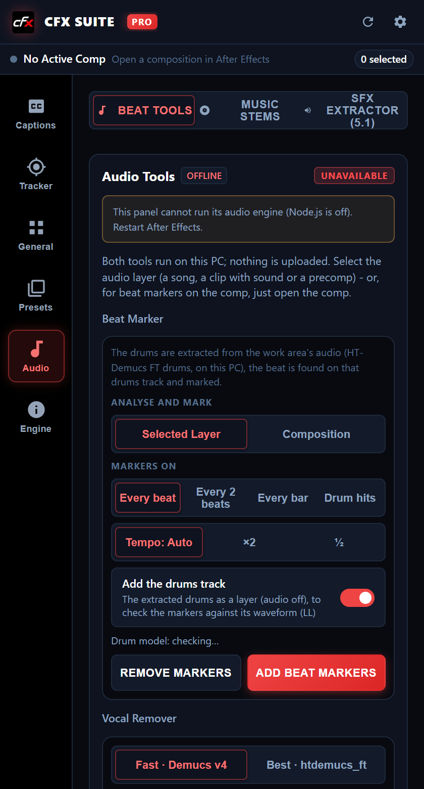
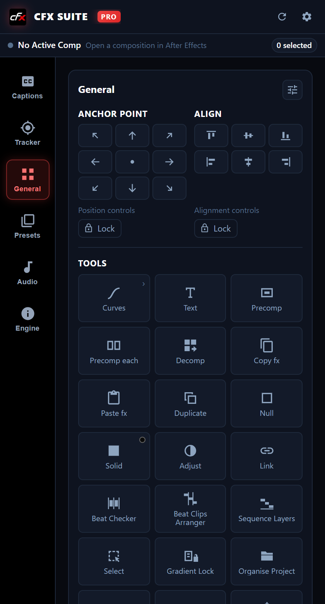

<div align="center">

# CFX SUITE PRO
### Neon Elite Edition &bull; Adobe After Effects Extension

[](https://github.com/dilipparvee2603-ui/CFX-SUITE-EXTENSION)
[](https://www.adobe.com/products/aftereffects.html)
[](https://github.com/dilipparvee2603-ui/CFX-SUITE-EXTENSION)
[](https://github.com/dilipparvee2603-ui/CFX-SUITE-EXTENSION/releases/tag/v1.0.0)

<br/>

**The all-in-one AI-powered editorial workspace for Adobe After Effects.**  
*Combines local Speech-to-Text, Neural Translation, Computer Vision Auto-Tracking, Beat Detection, Stem Separation, Seamless VFX Presets, and Precision Workflow Tools into a unified Neon Crimson interface.*

<br/>

<table align="center">
  <tr>
    <td align="center"><b>🎙️ Auto Captions & Translation</b></td>
    <td align="center"><b>🎯 Auto Tracker (Face & Point AI)</b></td>
  </tr>
  <tr>
    <td></td>
    <td></td>
  </tr>
  <tr>
    <td align="center"><b>⚡ VFX Presets (Shakes & Timing)</b></td>
    <td align="center"><b>⚡ VFX Presets (Twixtor Automation)</b></td>
  </tr>
  <tr>
    <td></td>
    <td></td>
  </tr>
  <tr>
    <td align="center"><b>🎵 Audio Studio (Beats & Stems)</b></td>
    <td align="center"><b>🛠️ General Workflow Tools</b></td>
  </tr>
  <tr>
    <td></td>
    <td></td>
  </tr>
</table>

---

</div>

## 🌟 Highlights & Core Architecture

CFX Suite integrates **6 Core Pillars** directly into After Effects via Adobe's Common Extensibility Platform (CEP 9.0+):

```
CFX SUITE FOR AFTER EFFECTS
├── 🎙️ 1. AUTO CAPTIONS    ── Offline Whisper Large-V3 + MADLAD-400 Translation
├── 🎯 2. AUTO TRACKER     ── Local YuNet AI Face Detection + KLT Point Tracking
├── ⚡ 3. VFX PRESETS      ── Dynamic Center Zooms, Seamless Shakes & Twixtor Automation
├── 🎵 4. AUDIO STUDIO     ── Beat Marker (HT-Demucs), 5-Stems & 5.1 Center SFX Extractor
├── 🛠️ 5. GENERAL TOOLS    ── 1-Click Cut To F, Deep Un-Precompose, 9-Point Anchor, Bezier Curves
└── 💾 6. LAYER SETUPS     ── Save & Reuse Multi-Layer Rigs across Comps & Projects
```

---

## 🚀 The 6 Pillars in Detail

### 1. 🎙️ Auto Captions & Neural Translator
- **Offline Speech-to-Text**: Powered by local `faster-whisper` (Whisper Large-V3, 3.09 GB) with exact word-level timestamp boundaries.
- **Neural Translation**: Offline `MADLAD-400 3B` engine translating dialogue across Tamil, Hindi, Telugu, English, and 400+ languages.
- **One-Click Generation**: Automatically creates synchronized After Effects text layers with custom animation presets (karaoke highlight, pop-in, typewriter, fade).
- **Zero Cloud Latency**: 100% private, runs offline on your local GPU/CPU.

### 2. 🎯 Auto Tracker (Face & Point AI)
- **Computer Vision Model**: Offline ONNX YuNet face detection coupled with Lucas-Kanade optical flow feature tracking.
- **Automated Framing**: Dynamically generates tracking Nulls and scales bounding boxes to keep subjects perfectly centered.
- **Motion Smoothing**: Built-in Savitzky-Golay filtering removes micro-jitter while preserving dynamic camera motion.

### 3. ⚡ VFX Presets (Shakes, Zooms & Twixtor)
- **Seamless Shakes**: High-energy camera shakes with optional keyframe stretching to layer duration.
- **Dynamic Zooms**: Automatically computes active comp dimensions (`width/2`, `height/2`) to lock zoom centers without manual positioning.
- **Twixtor Automation**:
  - **Twixtor Dialog**: Auto-applies dialogue preset, configures custom FPS, and unchecks *"In FPS is Out FPS"*.
  - **Twixtor Speedramp**: Configures velocity curves and time-stretches speedramp keyframes cleanly.

### 4. 🎵 Audio Studio (Beats, Stems & 5.1 SFX)
- **AI Beat Marker**: Extracts drum transients using `HT-Demucs FT Drums` (ONNX) and stamps comp markers on the rhythm.
- **Music Stem Separation**: Isolates vocals, drums, bass, and instrumental tracks using Demucs v4.
- **5.1 Center Channel Extractor**: Extracts the center audio channel from movie dialogue and sound effects while stripping background score and ambiances.

### 5. 🛠️ General Workflow Tools
- **1-Click Cut To F**: Instant playhead split, trimming, and sequenced arrangement.
- **Deep Un-Precompose**: Flattens nested precomps into parent comp while preserving expressions, 3D flags, keyframes, and effect references.
- **9-Point Anchor Grid**: Snaps layer anchor points to Top-Left, Center, Bottom-Right, etc. without shifting visual layer position.
- **Cubic Bezier Easing**: Precise velocity curve injection for smooth keyframe transitions.

### 6. 💾 Layer Setups
- **Save & Reuse Rigs**: Bundle complex layers (effects, mattes, adjustment layers, text, parenting) into named setups.
- **Timeline Placement**: Restore setups at Current Time Indicator (CTI) or original timestamps across any comp or project.

---

## 📥 Installation

### Method 1: Portable 1-Click Installer (Recommended)
1. Download the latest **`CFX_Suite_v1.0_Extension.zip`** from [Releases](https://github.com/dilipparvee2603-ui/CFX-SUITE-EXTENSION/releases).
2. Extract the ZIP to any folder.
3. Double-click **`Install_CFX_Suite.bat`**.
4. The installer automatically:
   - Copies files into `%APPDATA%\Adobe\CEP\extensions\com.cfx.suite\`.
   - Enables Adobe CEP debug mode in Windows Registry (`CSXS 7` through `17`).
5. Open **Adobe After Effects** ➔ **Window ➔ Extensions ➔ CFX Suite**.

### Method 2: Official `.zxp` Package
1. Download **`CFX_Suite.zxp`** from [Releases](https://github.com/dilipparvee2603-ui/CFX-SUITE-EXTENSION/releases).
2. Install via **Anastasiy’s Extension Manager** or **ZXP Installer**.
3. Launch After Effects and find **CFX Suite** under **Window ➔ Extensions**.

---

## ⚙️ System Requirements

| Component | Minimum | Recommended |
| :--- | :--- | :--- |
| **Operating System** | Windows 10 (64-bit) | Windows 11 (64-bit) |
| **After Effects** | After Effects 2020 (17.0) | After Effects 2023 - 2026+ |
| **Memory (RAM)** | 8 GB | 16 GB - 32 GB |
| **GPU Acceleration** | DirectX 11 / OpenGL | NVIDIA CUDA (cuBLAS 12 supported) |
| **Disk Space** | 500 MB for core tools | 3.5 GB for offline speech models |

---

## 🧠 Offline AI Model Cache

All AI speech, translation, and audio models are pinned to verified SHA-256 cryptographic hashes in `whisper/models.json` and cached locally at:
```text
C:\Users\<Username>\.cache\dala_whisper\models\
 ├── large-v3/              (Whisper Large-V3 - 3.09 GB)
 ├── madlad-3b/             (MADLAD-400 3B - 2.97 GB)
 ├── htdemucs_ft_drums/     (HT-Demucs FT Drums - 166 MB)
 └── htdemucs/              (Demucs v4 Vocal Remover - 84 MB)
```
*(Downloads feature built-in HTTP Range resume and automatic corruption verification).*

---

## 🎨 Visual Identity

- **Theme**: CFX SCP Neon Elite Crimson
- **Primary Color**: `#ef4444` (Crimson / Neon Red)
- **Stage Background**: `#080A10`
- **Surface Elevation**: `#0E131F` / `#131A29`
- **Typography**: Inter (Clean High-DPI UI font)

---

## 📄 License & Credits

- Designed and Developed by **CFX Studios** & **CfxEdits**.
- Powered by `faster-whisper`, `CTranslate2`, `Demucs v4`, and `OpenCV YuNet`.
- Built specifically for the **CFX SCP** ecosystem.

For updates and feedback, visit [CFX-SUITE-EXTENSION](https://github.com/dilipparvee2603-ui/CFX-SUITE-EXTENSION).
